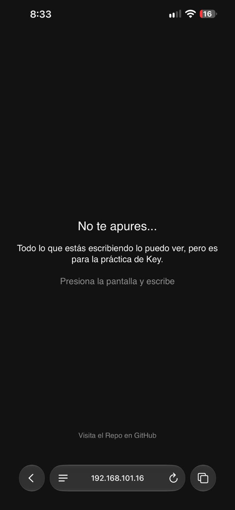
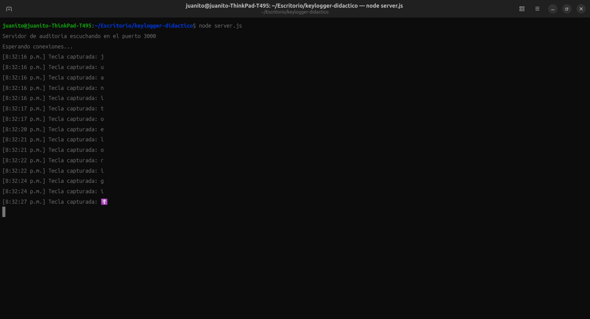

# Keylogger Didáctico (PoC) 🛡️





Prueba de Concepto (PoC) desarrollada para la clase de Seguridad Informática. Este proyecto demuestra cómo funciona la captura de eventos de teclado a nivel de aplicación (*Application-Level Logging*) utilizando una arquitectura Cliente-Servidor en una red local (LAN).

> ⚠️ **Advertencia Ética:** Este proyecto tiene fines estrictamente educativos y didácticos. El registro de teclas ocurre únicamente dentro de un entorno controlado, visible y autorizado mediante consentimiento explícito del usuario. No registra datos en segundo plano ni fuera del alcance del navegador.

## ⚙️ Arquitectura y Flujo de Funcionamiento

El proyecto se compone de dos partes operando en la misma red local:

1. **Cliente Web (Frontend):** Una interfaz minimalista en HTML/JS servida al dispositivo móvil (ej. iPhone). Utiliza un campo de texto transparente que abarca toda la pantalla. Al presionar la pantalla e ingresar texto, el navegador captura el evento de manipulación del DOM (`input`).
2. **Exfiltración de Datos (Fetch API):** Mediante JavaScript asíncrono, cada carácter ingresado se empaqueta en un objeto JSON y se envía al servidor mediante el método HTTP POST.
3. **Servidor (Backend - Node.js):** Un servidor local construido con Express.js (ejecutado en Linux/Ubuntu) que escucha en el puerto 3000. Recibe el *payload* y lo imprime en tiempo real en la terminal (`stdout`).

## 🚀 Cómo replicarlo en tu entorno local

### Prerrequisitos
- Tener [Node.js](https://nodejs.org/) instalado en tu equipo.
- El dispositivo atacante (Servidor) y el dispositivo objetivo (Cliente) deben estar conectados a la **misma red Wi-Fi**.

### Instalación y Ejecución

1. **Clonar el repositorio:**
   ```bash
   git clone [https://github.com/juanitoelorigi/keylogger-poC.git](https://github.com/juanitoelorigi/keylogger-poC.git)
   cd keylogger-poC
Instalar dependencias:

```bash
npm install express cors
```

Averiguar tu IP Local:
Abre una terminal en tu computadora (Linux/Mac) y ejecuta:


```bash
ip a

```

Busca la dirección IP asignada a tu interfaz inalámbrica (normalmente empieza con 192.168.x.x).

Iniciar el Servidor:
Ejecuta el servidor en la terminal:


```bash
node server.js

```

Deberás ver el mensaje: Servidor listo en el puerto 3000. Esperando teclas...

Conectar el Cliente:
En el navegador del dispositivo objetivo (ej. Safari en un iPhone), ingresa la siguiente URL, sustituyendo la IP por la tuya:


```Plaintext
http://TU_IP_LOCAL:3000
```

📱 Uso de la Demostración
Una vez dentro de la página web desde el móvil, toca en cualquier parte de la pantalla (fondo oscuro). El teclado virtual se desplegará. Todo lo que escribas será invisible en la pantalla del teléfono, pero se registrará instantáneamente en la terminal del servidor Node.js.
